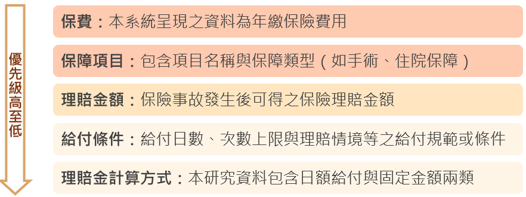
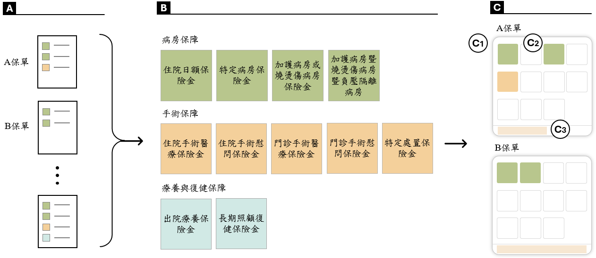
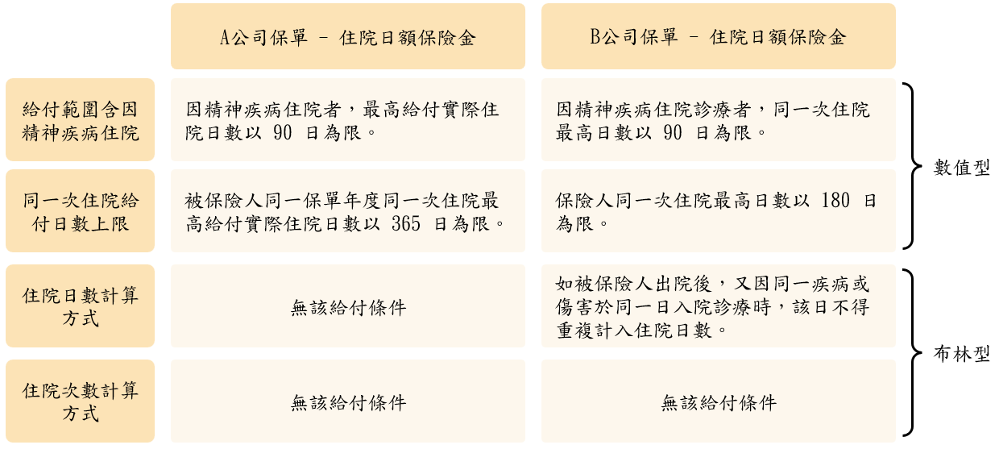
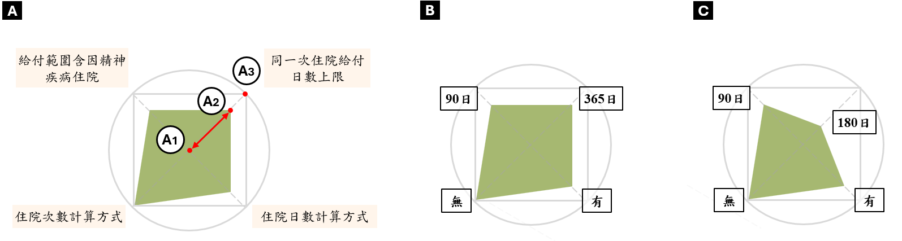
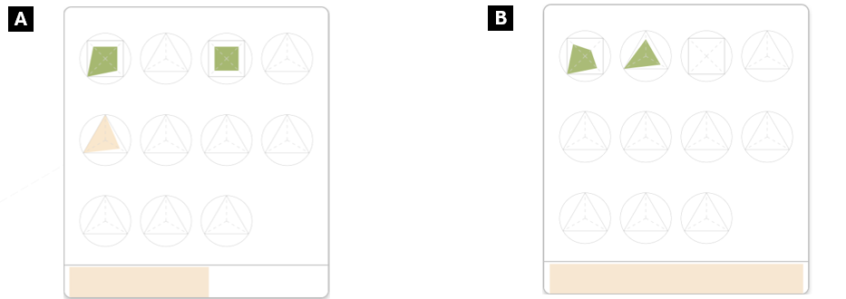
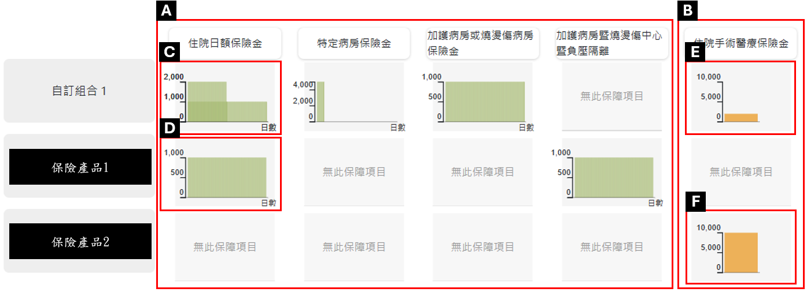
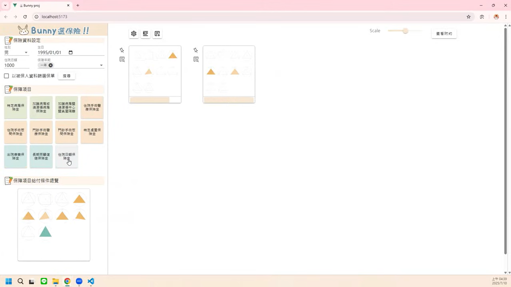

# Bunny選保險 — 健康保險決策輔助系統

💡 本系統為碩士論文之開發成果

<blockquote style="background-color: #f0f4f8; border: 0px; border-radius: 6px; padding: 18px 0px 5px 20px; margin: 0; color: #24292f; line-height: 1.75;">

<b>國立中山大學 資訊管理所 ｜ 113學年度碩士論文</b> 
論文題目：以資料視覺化輔助健康保險決策之方法 
作者：連心怡 
指導教授：韓毅 教授 

</blockquote>

## 1. 摘要
購買健康保險可增加生活保障，避免因疾病而遭遇經濟困難。然而，健康保險契約資訊複雜且多以文字呈現，使消費者不易理解保障內容與比較產品差異。同時，健康保險產品選擇眾多，決策過程存在選擇過載的問題。現有健康保險決策輔助研究多透過教學提升保險識能，針對多項產品比較的設計仍較有限，亦較少運用視覺化呈現產品間的異同。另有研究透過推薦與排序減少選擇過載，但此類方法可能簡化使用者探索產品的過程，使其不易從比較中逐步釐清自身需求，無法找到最適合的保險產品。 

因此本研究開發 **Bunny 選保險** 健康保險決策輔助系統，將保險契約的各項資訊視覺化，依重要程度分層呈現，以配合不同決策階段的比較需求，並輔助使用者理解健康保險之保障效果。

## 2. 視覺化設計說明

根據過往研究指出的保險決策考量因素(Vardell, 2017<a href="#ref1">1</a>; Vardell & Wang, 2024<a href="#ref2">2</a>)，以及健康保險識能與健康數理識能不足、選擇過載之決策挑戰(Adepoju et al., 2019<a href="#ref3">3</a>; Reyna et al., 2009<a href="#ref4">4</a>; Barnes et al,2015<a href="#ref5">5</a>) ，本研究提出四個設計需求：

* **R1**. 視覺化健康保險契約條款 
* **R2**. 視覺化健康保險產品保障效果
* **R3**. 篩選健康保險產品
* **R4**. 並列比較多項保險產品的保障項目與效果

除上述核心設計需求，在保險決策中，使用者的決策可能隨對資料的探索改變，透過探索跟比較可能增進其保險知識，進而重新調整對保障目標的需求。因此，這個決策流程不是單向線性的，系統設計上要考量使用者可能跳回決策流程的各階段，設計上要有支援各階段需求切換的彈性。此外，消費者在保險決策過程傾向採用縮減選擇集的策略(Mechanic, 1989<a href="#ref6">6</a>)，我們認為應將最具決定性的資訊優先呈現，細節資訊則配合篩選與比較的流程分層次呈現。故我們將各保險因子劃分視覺化優先級，並以分層呈現作為主要設計原則（圖1）。

  

  <b>圖 1</b>： 保險決策因素視覺化優先度分級

### 2.1 健康保險概覽設計
我們參考保單文件的意象，將保險產品以形似空白紙張的方塊表示（圖2 C1），並將視覺化後的條款資訊置於其中，以便各保單間並列比較。根據前述優先級的劃分，保障項目與保費為保險契約資訊中的第一優先級，故在健康保險視覺化設計( R1 )中，我們首先突出保障項目與保費的差異，再逐步納入後續優先級的資訊。

* **保障項目**：保障項目有無屬於二元資訊，我們採用二元矩陣設計，將保障項目轉為方形單元格（圖2 C2）。保單方塊所含的單元格為保障項目集合（圖2 B），若保單涵蓋該保障項目，則對應單元格填色，否則留白。

* **保障項目分類**：以顏色進行視覺化，以綠色表示各類病房保障，橘色代表手術相關保障，藍色則為療養與復健保障（圖2 B），將前述二元矩陣進一步設計為二值熱圖。

* **保費**：以長條圖呈現，考量其在投保決策中與保障項目同樣重要，故將其置於保單方塊底部，與保障項目單元格在同一層級並列呈現（圖2 C3）。 

  

  <b>圖 2</b>： 保險契約視覺化設計圖，(A) 將所有保險契約之保障項目抽取集合；(B) 保障項目集合可分類為病房保障、手術保障與療養與復健保障，並以顏色進對應分類視覺化；(C) 保險產品經視覺化後以方塊表示(C1)，保障項目集合以二元矩陣的設計至於其中(C2)，保費則以置底長條圖呈現(C3)。

 建立二值熱圖的架構後，我們將第二優先級的理賠金額加入設計。

* **理賠金額**：以保障項目單元格（圖2 C2）的顏色透明度進行對應，顏色越深則該保障項目理賠金額越高。

最後，我們將第三優先級的給付條件加入保單概覽設計。由於二值熱圖的保單契約視覺化主要用於概覽與初步比較，故較為複雜且為第三優先級之理賠金額計算方式將另於其他視圖呈現（詳見2.2節）。給付條件的資料類型較複雜，如表1，由於不同產品的保障項目給付條件可能不同，可能出現一保單之某保障項目包含某項給付條件，然另一保單之該保障項目未包含該條件之情形。基於此，我們首先將各保單之保障項目有無包含給付條件視為一比較維度。在有含有該給付條件的情況下，條文可能還包含數值類資訊。此類數值差異可能使含有相同保障項目的保單在實際理賠效果上有所不同，因此這些數值資訊亦應作為一維度予以呈現。綜上所述，依據保障項目對給付條件集合的涵蓋關係，以及給付條件是否含數值資訊，可將保障項目之給付條件狀態歸納為三種類型：**(1)** 不包含該給付條件，為布林型別中的「無(false)」； **(2)** 包含該給付條件但不涉及數值資訊，為布林型別中的「有(true)」；以及 **(3)** 包含該給付條件且附帶數值資訊，屬於數值型資料(numeric)。 

  <b>表 1</b>： 保障項目給付條件比較表

  

 

* **給付條件**：給付條件屬於多維度資訊，且部分維度為數值，雷達圖能透過角度清楚區分各維度、並以長度呈現數值大小，適合呈現多維度資料，故我們將雷達圖結合布林型資料進行設計。考量給付條件多屬於對保障項目給付的限制規範，亦即在其他條件相同的情況下，包含給付條件的情境通常劣於不包含給付條件者；此外，在數值型給付條件中，如給付日數或次數，其數值愈大亦代表條件愈為寬鬆，保障效果愈佳。基於上述特性，在設計方面，我們希望整體呈現能讓條件愈佳者愈顯眼。因此當保障項目未包含特定給付條件時，其值配置於雷達圖的最外側（圖3 A3）；若包含給付條件但不具數值資訊（圖3 A2），則配置於較內側的節點；而對於具數值型資訊的給付條件，則由小至大線性對應於 A1 至 A2 間，數值愈大者愈接近外圍。透過此配置方式，雷達圖的面積得以在視覺上反映給付條件之相對寬鬆程度，使保障效果較佳的情境呈現出較大的面積，作為使用者進行初步比較時的整體視覺線索。

  

  <b>圖 3</b>： 範例保單之住院醫療保險金雷達圖設計，透過面積反映條件的嚴格程度，(A) 透過將雷達圖分區可以呈現有該條件（A2處）或無該條件（A3處），
並可呈現數值（紅色箭號處，即A1至A2區間)；(B) A公司保險契約之住院醫療保險金雷達圖；(C) B公司保險契約之住院醫療保險金雷達圖。 

 
將各資訊進行視覺化後，我們以表1之兩保單為範例呈現完整健康保險概覽設計（圖4）。

 

  

  <b>圖 4</b>： (A) 表1之A公司保險契約之完整視覺化；(B) 表1之B公司保險契約之完整視覺化。

### 2.2 健康保險保障效果視覺化設計
透過前節之健康保險概覽設計，消費者已可知悉大部分保險產品資訊，並可進行篩選。然保險概覽設計僅呈現最高理賠金額，各保險金會因契約規範之給付而在實務運作有所不同。因此，我們依循分層及按資訊優先級呈現的設計原則，將「理賠金額」與「理賠金計算方式」資訊抽出，透過保障效果視覺化設計進一步呈現。

* **理賠金額**：鑒於設計之維度較少且須顯示精確數額，我們使用直方圖呈現各保單於各保障項目的理賠金額（圖5）。此外，我們將各保單垂直並列以利比較（R2、R4）。

* **理賠金計算方式**：本研究資料之理賠金額計算方式分為「日額給付」與「固定金額」兩類，前者以綠色直方圖表示，後者則以橘色對應。「日額給付」保障項目之理賠金額依住院天數變動，因此其直方圖橫軸為日數、縱軸為金額（圖5 A ），以呈現該保障的理賠總日數上限與每日的理賠日額，如圖5 C 與圖5 D ，可觀察到圖5 C 理賠日額隨住院天數有所變化，住院之前180日每日理賠金額為2000元，180日至365日則降為1000元；而圖5 D 的理賠日額則皆為每日1000元。「固定金額」保障項目之直方圖僅需呈現金額（圖5 B），如圖5 E與圖5 F，保單間可直接比較同保障項目的理賠金額。 

  

  <b>圖 5</b>： 保障效果視覺化設計， A 為日額給付型之保險金， B 為固定金額之保險金。 C 與 D 皆為日額給付保險金，兩者的最高給付住院天數皆為365日，然 C 之住院日額隨連續住院天數變動， D 則固定為1000元日額。 E 與 F 皆為固定金額保險金，透過垂直比較可發現 F 之理賠金額較E高。

## 3. Demo Video
🔻**點擊觀看 Youtube Demo 影片** 
🔗

## 4. Live Demo
🔗https://bunny-ins-select-jade.vercel.app/

## 5. 開發工具
* **資料庫**：MySQL
* **前端介面**：Vue.js、D3.js
* **線上部署**：Supabase、Vercel

## 6. Reference

1. Vardell, E. J. (2017). Health insurance literacy: How people understand and make health insurance purchase decisions (Publication No. 10283966) [Doctoral dissertation, The University of North Carolina at Chapel Hill]. ProQuest Dissertations & Theses Global.

2. Vardell, E. J., & Wang, T. (2024). The information behaviour of individuals changing health insurance plans and an exploration of health insurance priorities. Journal of Information Science, 50(3), 751-765.

3. Adepoju, O., Mask, A., & McLeod, A. (2019). Factors associated with health insurance literacy: proficiency in finding, selecting, and making appropriate decisions. Journal of Healthcare Management, 64(2), 79-89.

4. Reyna, V. F., Nelson, W. L., Han, P. K., & Dieckmann, N. F. (2009). How numeracy influences risk comprehension and medical decision making. Psychological Bulletin, 135(6), 943–973. https://doi.org/10.1037/a0017327

5. Barnes, A. J., Hanoch, Y., & Rice, T. (2015). Determinants of coverage decisions in health insurance marketplaces: consumers' decision‐making abilities and the amount of information in their choice environment. Health Services Research, 50(1), 58-80.

6. Mechanic, D. (1989). Consumer choice among health insurance options. Health Affairs, 8(1), 138-148.